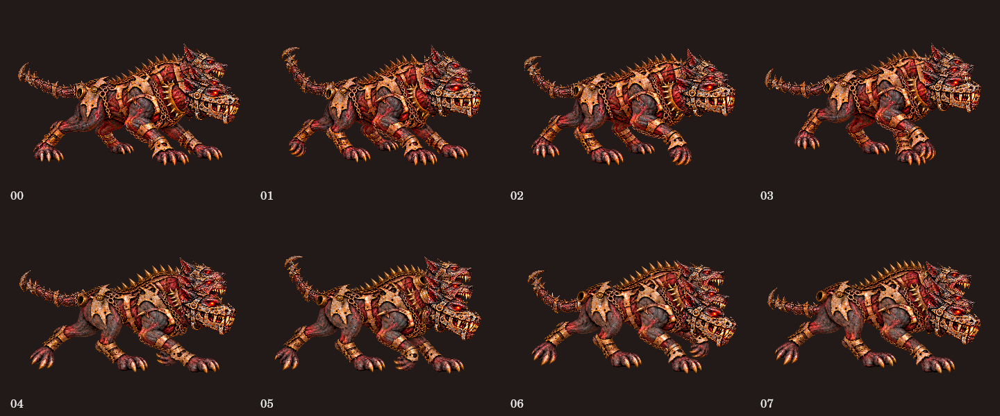
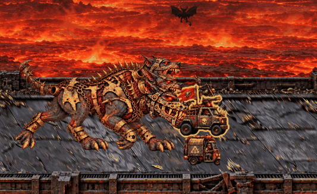
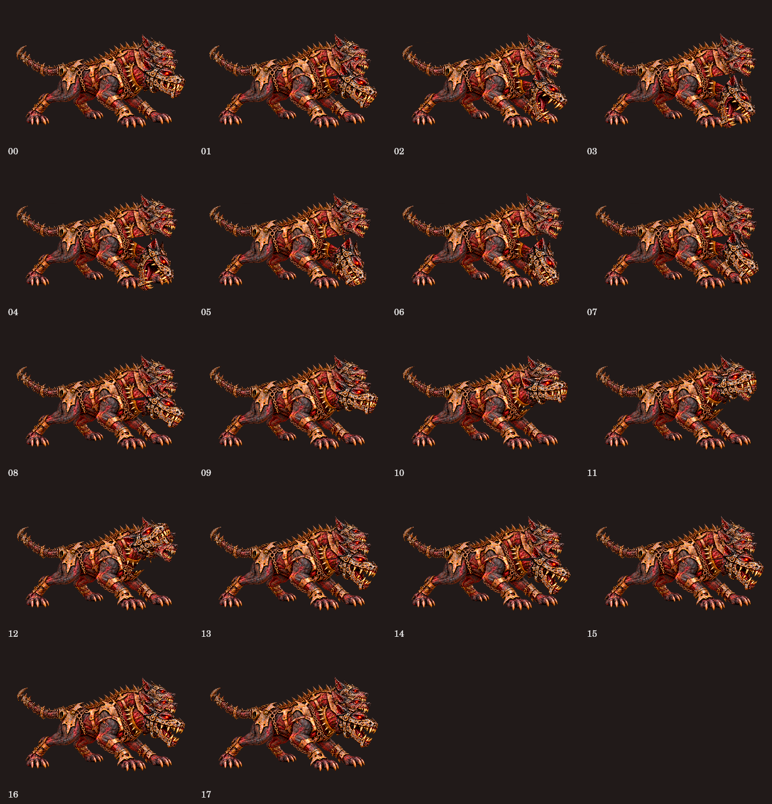
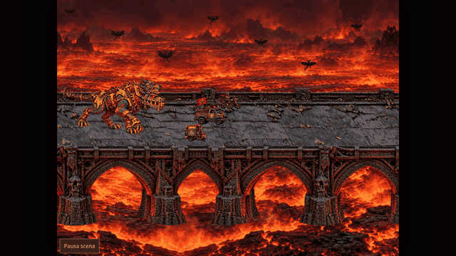
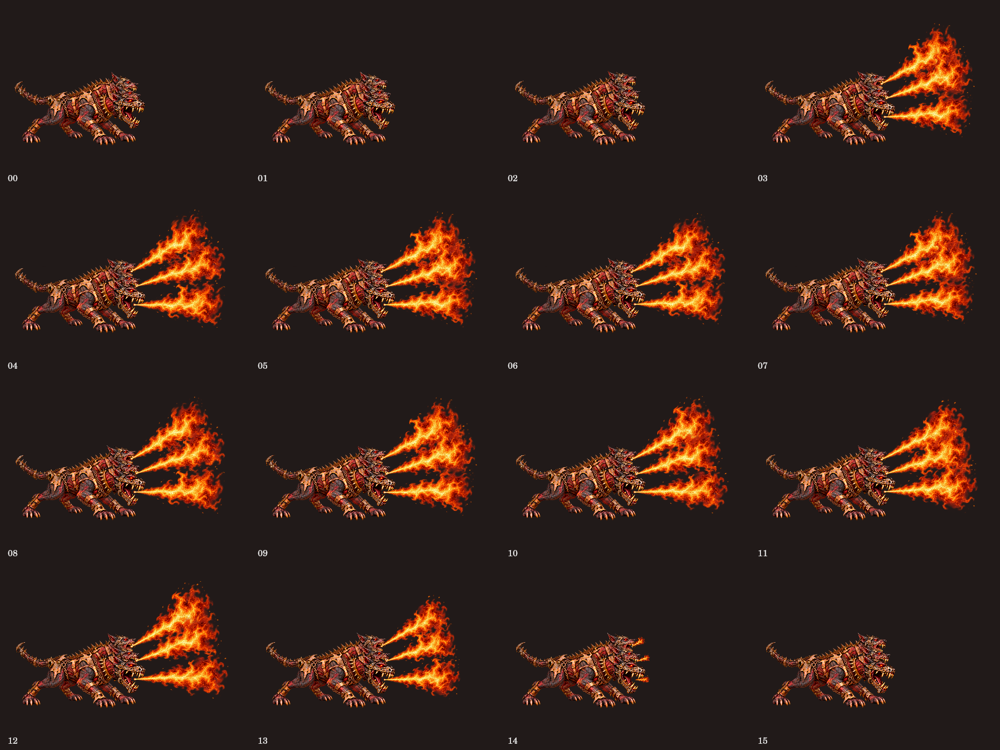
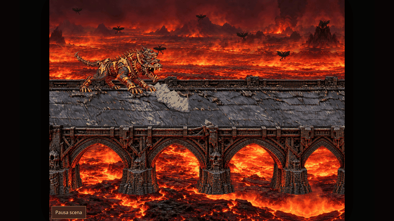

# Cerbero: passo canino, morso e lancio nella lava

Questa revisione sostituisce il rig a mesh v1 respinto dall’utente. Conserva il riferimento rosso/carnoso approvato e la fiala Arsenico già integrata nella PR #52. Ponte, lava, portale, dimensioni dei veicoli e disposizione dei pannelli restano nel riferimento approvato.

## Disegni e articolazioni

Il runtime usa cinque atlanti RGBA nativi 1536×1024 in `assets/hell-race/cerbero-v2/`. Sono conversioni WebP senza perdita dei disegni generati: il confronto RGBA esatto è stato verificato. Origini e impronte sono in `assets/hell-cerbero-frames.js`.

- `body-a` e `body-b`: otto pose disegnate di corpo e quattro zampe, a scala comune; ciclo di 32 unità, 12 pose/s alla velocità ordinaria di 48 unità/s.
- `parts`: tre crani e una coda. I colli sono estratti dai rispettivi disegni del corpo con raccordi arrotondati. Colli e crani ruotano come parti rigide, con fasi indipendenti; la coda ha tre segmenti sovrapposti, con ritardo dalla base alla punta.
- `jaw`: quattro disegni della testa bassa, con bocca chiusa, apertura, presa e rilascio; mantiene la gabbia mandibolare del riferimento.
- `flames`: quattro disegni di getto, con punto d’innesco misurato per ciascun frame, ancorati separatamente alle tre bocche trasformate.

È un’animazione composta da pose disegnate e parti articolate: le tavole di controllo del morso e del fuoco mostrano campioni di questa composizione, non sedici ridisegni completi indipendenti. Non usa deformazioni a mesh o variazioni di scala lungo un singolo asse. Gli ID delle teste restano `left` (alta/lontana), `center`, `right` (bassa/vicina, responsabile del morso).

## Cattura e mezzi rigidi

Una cattura dura 5,2 s: morso a 1,05 s, caricamento della testa da 1,35 s, rilascio a 1,95 s. Il quarto posteriore del mezzo resta ancorato alla bocca tramite la stessa trasformazione usata dal disegno. Le zampe non afferrano il veicolo.

`hell-throw.js` calcola il moto nel mondo e la proiezione: il mezzo attraversa il parapetto vicino, cade ruotando e tocca la lava dopo 1,6 s di volo. In primo piano viene dipinto dopo il parapetto. L’affondamento dura 1,1 s e nasconde i pixel sotto la superficie; non riduce dimensioni o opacità del mezzo. Spruzzi e increspatura partono dal punto d’impatto.

Tutti i veicoli usano il medesimo disegno canonico per ogni richiesta di frame. La strada aggiunge soltanto piccoli spostamenti verticali e inclinazioni, con dimensioni costanti. Il test raster confronta l’intera matrice RGBA fra gli otto frame richiesti per ogni mezzo.

Movimento, particelle e traiettorie dipendono da tempo attivo e distanza; la pausa congela la scena. Il renderer non scrive nel modello di gioco. Il finale mantiene attraversamento e crollo del portale, reazione delle teste e fuoco dalle tre bocche; il Game Over frena la camera prima dell’esultanza su zampe appoggiate.

## Punti e compatibilità

Nuove partite e impostazioni predefinite: facile **111**, media **222**, difficile **333**, sia sul sito sia nell’export offline. Profili e salvataggi con valori espliciti conservano i propri punti. Antisigillo è già escluso dal catalogo attivo e filtrato dai vecchi salvataggi nella serie Omen; questa PR non è stata unita a `main`.

## Verifiche ed evidenze

Comandi pertinenti:

```sh
npm test
npm run test:frames
npm run build
npm run test:offline
npm run test:chase
npm run test:endings
npm run test:orientation
node scripts/render-audit.cjs
node scripts/cerbero-sequences.cjs
python3 scripts/review-cerbero-v2.py
```

Le tavole `evidence/*-sprites.png` sono controlli della composizione. Le GIF sono registrazioni reali di Chromium, senza sostituire renderer o timeline, a 20 FPS. Il rapporto `evidence/report.json` registra revisione runtime, impronte dei file, viewport, durata e dimensioni esportate. La finestra è 1366×768; la camminata è un ritaglio della scena, il lancio è esportato a 640×360 e le fiammate a 768×432. `points-report.json` documenta default e conservazione dei valori personalizzati su sito/offline.













Acquisizione runtime: `1caa1f47d9a1672b939247a510210bd87ec49d0f`. Gli allegati vengono aggiunti in un commit successivo senza modifiche al runtime. Camminata: 3,2 s; morso/lancio/lava: 5,4 s; tre bocche: 1,6 s. Tutte le clip mantengono 20 FPS.

Verifiche locali riuscite: 157 test Node e dataset, suite frame completa, build, offline su tre viewport e due banche, finali con pausa/visibilità/movimento ridotto, inseguimento con 0/1/2 perdenti e dieci campioni offline, orientamento su sito/export/schermo intero. L’audit usa tre configurazioni di viewport/DPR e registra dimensioni native e tempi osservati, senza promettere FPS su altri dispositivi.
