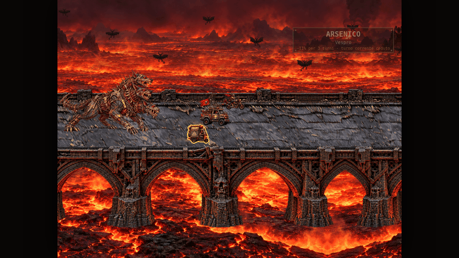
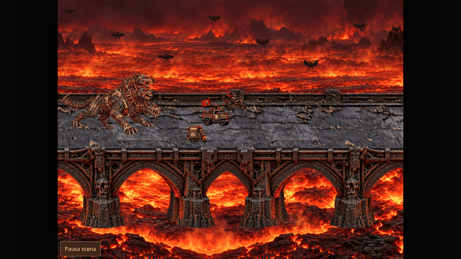
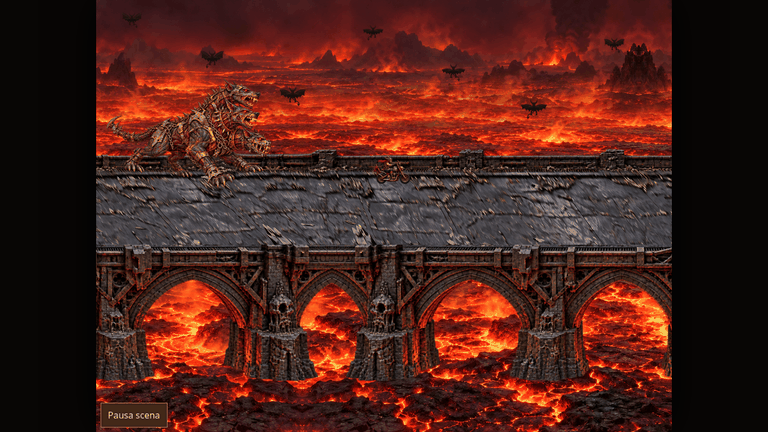
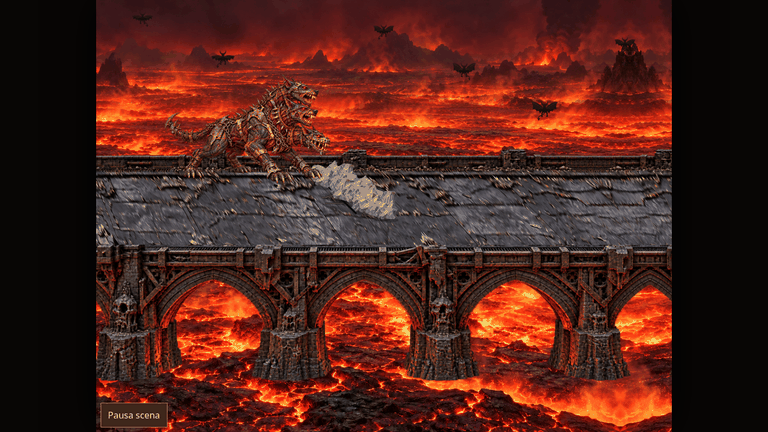
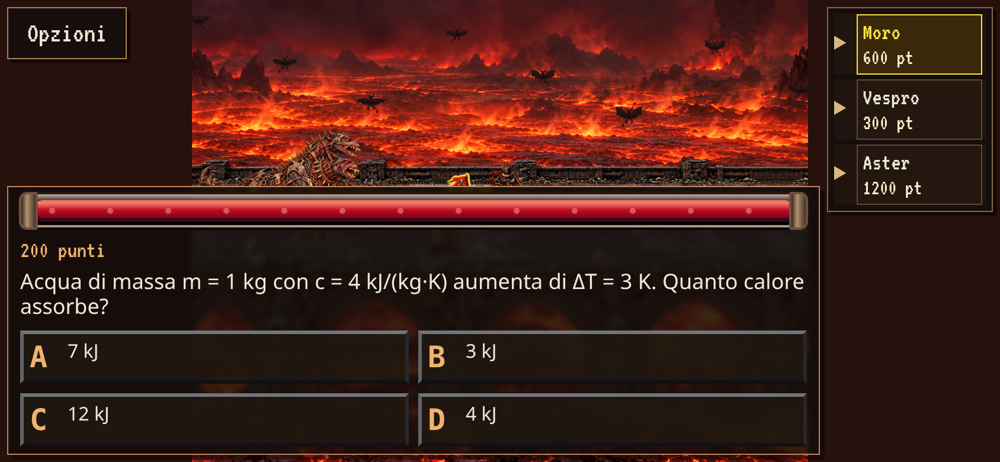

# Cerbero carne e Arsenico — integrazione v1

Design approvati dall’utente: «Approvo tutto, preferisco quello più rosso carne».
Questa consegna prosegue le PR [#50](https://github.com/rickymusu-bit/quiz/pull/50)
e [#51](https://github.com/rickymusu-bit/quiz/pull/51), senza merge automatico.

Il Cerbero usa esattamente la proposta rossa `cerbero-proposta.png` della PR #51,
copiata senza modifiche in `assets/hell-race/cerbero/carne-v1.png`. La stessa
texture alimenta tutte le pose. La fiala approvata diventa
`assets/hell-race/arsenico-v1.png`: sostituisce «As» nell’inventario e vola
verso il bersaglio durante l’attivazione. Le regole e i salvataggi non cambiano.

## Rig e azioni

[rig-v1.json](rig-v1.json) descrive coordinate, gerarchia, limiti e impronta del
riferimento. Il codice autoritativo è `assets/hell-cerbero.js`.
Tre catene torace → collo → testa → mandibola, quattro zampe e una coda muovono
una mesh connessa. Gli identificatori delle bocche non dipendono dalla posizione
sullo schermo: `left` è la testa alta/lontana, `center` quella mediana, `right`
quella bassa/vicina. Nessuna testa è aggiunta o ridisegnata fra le pose.

| Azione | Movimento e ancoraggi |
| --- | --- |
| Corsa e accelerazione | Passo lungo 64 unità del mondo, appoggio al 60%, diagonali alternate. Le zampe in appoggio compensano lo scorrimento del terreno. Teste e coda accompagnano il passo. |
| Cattura, 5,2 s | Avvicinamento fino a 0,9 s; presa fino a 1,2; sollevamento fino a 2,05; passaggio alla bocca fino a 2,45; veicolo nascosto entro 3,05; recupero da 3,7. Presa e occlusione usano gli ancoraggi del rig. |
| Reazione finale | Tre impatti delle zampe anteriori dopo il crollo; preparazione delle teste, tre getti simultanei, recupero e respiro. La direzione iniziale di ciascun getto deriva dalla sua bocca trasformata. |
| Game Over | Catture dei soli veicoli ancora presenti, poi breve movimento di esultanza della creatura. Nessun portale. |

Fuoco e polvere restano livelli separati. I getti partono dalle tre bocche;
la polvere nasce dagli appoggi e resta nel riferimento del terreno dopo l’urto.
Il tempo attivo e la distanza pilotano il rig, senza contare i render o usare
il generatore casuale della partita. Pausa, orientamento e movimento ridotto
continuano a usare il controllo della scena esistente.

La texture mantiene risoluzione, trasparenza e scala uniforme. I vecchi atlanti
bipedi rimangono come materiale storico, esclusi dal caricamento runtime e
dall’export offline. Il renderer finale riusa il rig di corsa; eliminati
l’estrazione dei vecchi frame e il relativo codice di polvere.

## Verifiche riproducibili

- `npm test`: motore, Omen, turni, punteggi esatti, salvataggi e nuovo rig.
- `npm run test:frames`: texture, sagome, pose, veicoli, polvere, fuoco e terreno.
- `npm run build`, `npm run preview:offline`: caricamento e asset incorporati.
- `python3 tests/chase_browser.py --quick`: 0/1/2 perdenti, presa, occlusione, pausa, rotazione, movimento ridotto, matrice offline desktop/mobile.
- `python3 tests/portal_browser.py --quick`: attraversamento, crollo, tre fiammate, pausa, Game Over, finale statico e matrice offline.
- `npm run test:omen`: Arsenico e layout nei controlli reali, salvataggio, rotazione e offline.
- `node scripts/render-audit.cjs`: risoluzione nativa e tempi del renderer; valori dipendenti dal browser/dispositivo, non un benchmark hardware.

I controlli geometrici verificano interpolazione dei giunti, quattro appoggi,
continuità del ciclo, determinismo a 30/60/144 campioni, assenza di inversioni
dei triangoli e corrispondenza tra rig e cattura. L’ispezione visiva delle
registrazioni completa questi controlli: i test da soli non certificano l’anatomia.

## Evidenze reali

`python3 scripts/review-cerbero.py` acquisisce il gioco in Chromium senza
sostituire il renderer. I punteggi e gli inventari iniziali sono fixture di prova;
l’attivazione di Arsenico passa dai controlli reali. Il rapporto registra revisione,
impronte dei file runtime, viewport, durata e file acquisiti.

Acquisizioni sulla revisione runtime `9a8398bc35967a0c3ed4c3f0a973d5957fcbcc2c`.
Gli allegati vengono aggiunti in un commit successivo senza cambiare il runtime.
Corsa/Arsenico: 4,5 s, 8 FPS; cattura: 5,2 s, 10 FPS; fuga/portale: 7,12 s,
8 FPS; reazione finale: 6,75 s, 8 FPS. [Rapporto](evidence/report.json),
[layout e Omen](evidence/omen-layout.json), [audit](evidence/render-audit.json).

Esiti locali: 152 test Node e validazione dataset riusciti; suite frame e build
riuscite; inseguimento e portale con 8 campioni offline viewport/DPR ciascuno;
Omen con 5 configurazioni desktop/mobile/offline e controllo delle posizioni
invertite. I rapporti dei tempi riportano il dispositivo virtuale di prova e
non rappresentano una promessa di FPS su altri dispositivi.

Le GIF sono registrazioni del browser, non animazioni generate del personaggio.
La finestra desktop è 1366×768; le GIF sono esportate a 768×432.
Lo screenshot mobile è 844×390, DPR 2. Il layout conserva domanda in basso che
si apre verso l’alto, barra del tempo sopra, Opzioni in alto a sinistra e lista giocatori in alto a destra.

