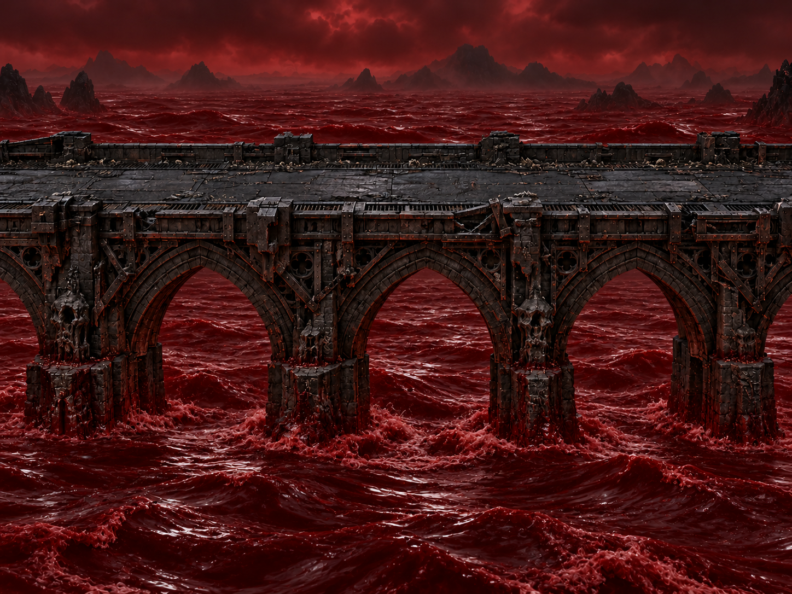

# Nuovo ponte — proposta da approvare

**Stato: progetto grafico statico, non integrato nel gioco.** Non è uno screenshot né una registrazione del renderer.

Richiesta corrente: ripartire dalla strada, scartando le colonne decorative proposte. Ponte di pietra e metallo neri, sopra un **mare di sangue**, in stile junkpunk, gotico e horror. Questa modifica sostituisce la lava della prima proposta.

La proposta conserva archi gotici portanti in pietra scura, pile strutturali immerse nel sangue, travi e controventi di ferro annerito, piastre, rivetti e giunti. Il piano carrabile è composto da lastre nere e metallo usurato. Il mare è liquido, scuro e non incandescente: onde, riflessi umidi, linee di contatto e scie attorno alle pile sostituiscono croste e fessure di lava. La luce proviene dal cielo cupo; i riflessi cremisi inferiori non sono emissione luminosa.

Coerenza fisica, prospettiva e appoggi prevalgono sulla visibilità costante dei veicoli: il bordo anteriore e la struttura potranno occluderli naturalmente. Le proporzioni di camera e piano carrabile saranno tradotte nella scena solo dopo l’approvazione del progetto.

Non riprendere integrazione, portale, Antisigillo o Sacrificio prima dell’approvazione della strada da parte dell’utente. Quando il ponte sarà integrato e dinamico, la verifica sarà una GIF reale del browser.

L’immagine è una nuova proposta generata con imagegen, conservata senza modifiche ai pixel. Non rappresenta una funzionalità già implementata.

La prima proposta con lava, `concept-v1.png`, resta soltanto come riferimento storico superato.
