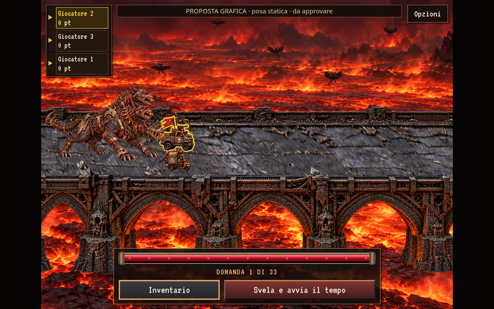
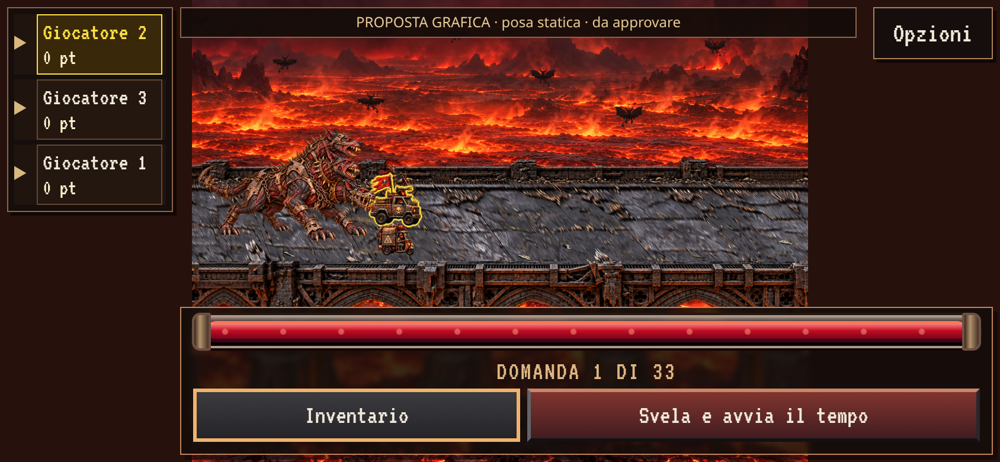
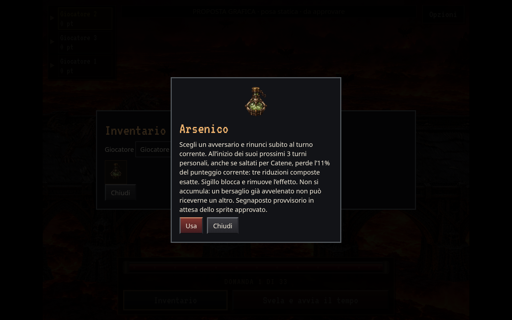

# Proposte Arsenico e Cerbero — v1

Stato: **proposte statiche da approvare**, prima di sprite animati e integrazione.
Riferimenti: [specifica della PR #49](../../HELLSCAPE_SPEC_OMEN_CERBERO_LAYOUT_v1.md),
[protocollo sprite v1](../../PROTOCOLLO_SPRITE_ANIMATI_v1_20261029.md).

## Arsenico

Fiala corta di vetro fumé con cristalli verde arsenico, ferro corroso, ossa e tappo
in ottone. La sagoma compatta è pensata per le dimensioni reali dell’inventario;
non contiene lettere, per restare riconoscibile anche nelle icone piccole.

`arsenico-proposta.png`: originale generato, RGBA 1254×1254, copiato senza modifiche.
La proposta si vede nell’inventario e nella finestra informativa nei due screenshot
`arsenico-inventario-*`. Nel gioco ordinario resta il segnaposto «As».

## Cerbero

Una creatura quadrupede con **tre teste canine, quattro zampe e una coda**.
Tre colli si raccordano a un solo torace; piastre irregolari, chiodature, catene e
rinforzi alle mandibole sono integrati nell’anatomia. Ferro annerito, carne scura,
ruggine e osso mantengono la palette del ponte e degli altri Omen. Le tre teste
sono disposte a ventaglio per distinguerle nella vista laterale a tre quarti.

`cerbero-proposta.png`: originale generato, RGBA 1536×1024, copiato senza modifiche.
Le screenshot `contesto-*` usano la stessa camera, terreno e scala del cacciatore
attuale. Una scala uniforme mantiene le proporzioni; il bordo inferiore della
sagoma rispetta il suo riferimento al suolo. La posa è singola: non è una prova
di locomozione, cattura o fiammata. Queste azioni richiederanno pose collegate,
ancoraggi verificati e GIF reali dopo l’approvazione del design.

## Revisione nel browser

`python3 scripts/review-omen-designs.py` avvia il gioco vero in Chromium e applica
la proposta **soltanto nel contesto isolato di revisione**. Il renderer intercettato
usa la posa di Cerbero al posto del solo disegno di corsa; una regola CSS locale
mostra la fiala nelle icone di Arsenico. Non ci sono import degli asset proposti
nel sito o nell’export offline, né modifiche ai file runtime.

Gli screenshot sono acquisizioni reali di questa revisione, con la dicitura
«PROPOSTA GRAFICA · posa statica · da approvare». Sono distinti dalle due immagini
generate degli asset, che non vengono presentate come screenshot del gioco.

Controlli eseguiti: caricamento con alpha, sagome contenute nel canvas, proporzioni
uniformi, screenshot desktop 1440×900 DPR 1 e mobile 844×390 DPR 2, inventario e
finestra Arsenico. Il modello della partita prima/dopo la revisione è identico;
un contesto normale conserva il segnaposto e il renderer approvato. Risultati e
impronte degli asset sono in `review-report.json`.

## Dopo l’approvazione

Il rig proposto in `rig-proposta.json` distingue tre catene torace → collo → testa
→ mandibola, quattro zampe e la coda. Le coordinate delle bocche sono riferimenti
manuali della sola posa v1, da validare sui keyframe approvati: non vengono usate
per emissioni o animazioni in questa consegna.

La produzione successiva dovrà raccordare inseguimento, accelerazione, presa e
divoramento, reazione finale. Ogni bocca avrà la propria origine per gli effetti;
il centro della creatura non verrà spostato per correggere emissioni errate.
Tempi e risultati di gioco resteranno quelli già verificati.

La specifica richiede: «La nuova grafica di Arsenico e Cerbero sarà progettata e
approvata in una seconda fase, prima dell’integrazione definitiva nel gioco».
Questa consegna prepara quella scelta; nessuna sostituzione definitiva è effettuata.

