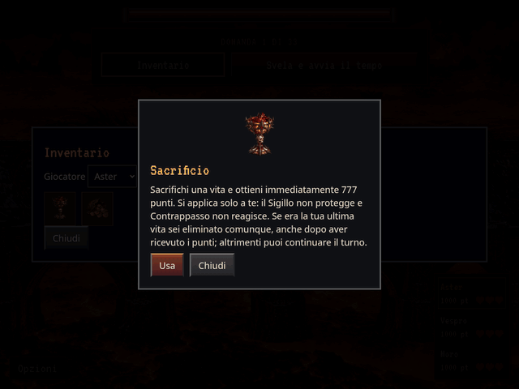

# Regole Ammo 22.0.0: Sacrificio e Tributo

GIF reale della schermata di partita in Chromium, dal codice `ea07410`.
Viewport 1024 × 768; esportazione 640 × 480; 12 secondi, 144 fotogrammi, 12 FPS.
Nessun mockup: tutte le schermate sono acquisite dal browser. La partita ha
una fixture controllata con tre dannati da 1000 punti e tre vite ciascuno.

1. Aster consulta e usa Sacrificio: 1000 → 1777 punti, 3 → 2 vite.
2. Aster consulta e usa Tributo su un avversario da 1000 punti: riceve 330 punti,
   raggiunge 2107, mentre il bersaglio resta a 670.
3. Il turno passa subito al dannato successivo. Contrappasso del bersaglio
   si trasforma in Tributo vincolato all’aggressore. Il quadro finale mostra
   punti, cuori e titolare aggiornati.

Le probabilità indipendenti predefinite sono Antisigillo 20% e Sacrificio 5%.
[Impostazioni reali](settings.png). Le regole precedenti da 1717 punti sono
superate: Sacrificio dà 777 punti e perde comunque una vita. L’ultima vita
comporta l’eliminazione anche dopo l’accredito.

Controlli completati:

- `npm test`: **117 test passati**, più verifica dei dataset. Incluse soglie
  indipendenti 20%/5%, trasferimenti razionali esatti e conservazione del totale,
  Sigillo, Contrappasso e vincoli, consumo singolo, turno corrente nascosto o
  già svelato, Catene pendenti, sospensione, ultima vita e migrazione 2.4.0.
- `node tests/ammo_icons.cjs`: nove icone distinte, risoluzione nativa.
- Build standard, export offline e demo Ammo completati.
- `node tests/gothic_preview.cjs`: nove effetti offline in tre viewport.
- `node tests/ammo_animation.cjs --case=sacrificio` e `--case=ruba`: animazioni
  reali su desktop, mobile verticale e orizzontale, nessuna mutazione dello
  stato durante il disegno e nessuna ripetizione dopo ridisegno.
- `python3 tests/ammo_rules_preview.py`: uso reale di entrambe le Ammo, punti,
  vite e turno verificati; pausa/ripresa e timer, domanda svelata ritirata,
  compatibilità dei salvataggi, ultima vita, default visibili 20%/5%; mobile
  offline con movimento ridotto senza richieste esterne o errori JavaScript.

Stati reali integrativi: [mobile verticale](after-390-844-False.png),
[orizzontale](after-844-390-False.png), [offline con movimento ridotto](after-390-844-True.png).

Compatibilità: eventuali Tributi già pendenti nei salvataggi vecchi terminano
una sola volta secondo la regola precedente. I nuovi usi trasferiscono subito
il 33%, senza condividere risposte future. La migrazione aggiorna il precedente
default Antisigillo 30% a 20% e aggiunge Sacrificio al 5%, conservando le altre
probabilità configurate, le vite e l’avanzamento, compresa la coda Ultimo Miglio.
