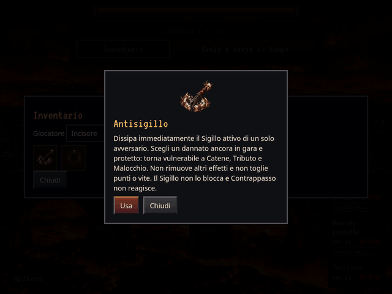

# Antisigillo: icona e frattura della protezione

Registrazione reale di Chromium, schermata di partita con inventario e conferma
uso, dalla revisione `4203011`. Viewport 1024 × 768, GIF esportata a 640 × 480:
6 secondi, 72 fotogrammi, acquisizione a 12 FPS. Il rapporto riporta SHA completo,
hash del file e verifiche. Fixture controllata: tre giocatori, un solo avversario
con Sigillo e una copia di Antisigillo nell’inventario del rispondente.

L’icona è una nuova reliquia di ferro annerito e osso. Il cuneo animato è uno
sprite rigido separato: avvicinamento, contatto, frattura, apertura e caduta di
due metà frastagliate, scomparsa della protezione. Le due immagini PNG sono
native, senza deformazioni o ritocchi. Le regole esistenti restano invariate.

Verifiche eseguite:

- `npm test`: 110 test passati e verifica dei dataset.
- `node tests/ammo_icons.cjs`: otto icone distinte a 48 px e risoluzione nativa.
- `npm run build` e `npm run preview:offline`: completati.
- `node tests/gothic_preview.cjs`: tutte le otto Ammo offline a 1280 × 1100,
  390 × 844 e 844 × 390.
- `python3 tests/antisigillo_preview.py`: uso attraverso l’interfaccia reale,
  un solo bersaglio protetto, una copia consumata, rimozione del solo Sigillo;
  punteggi e vite invariati, nessun Contrappasso. Stato del motore invariato
  durante la cinematica, pausa/ripresa e conservazione del timer, nessun replay
  dopo ridisegno. Su mobile, movimento ridotto statico e build offline senza
  richieste esterne. Nessun errore JavaScript.

Il portale approvato resta invariato. Sacrificio (−1 vita, +1717 punti a chi la
usa) è la prossima consegna separata e non fa parte di questo intervento.
