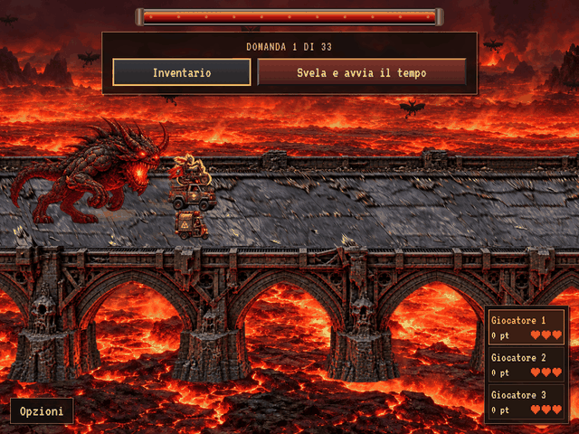

# Ponte: appoggi sulla lava e veicoli ingranditi

Schermata di gioco acquisita da Chromium sulla revisione `3c88158f73e159c018f0a7985ca12965d0c0c046`. Viewport 1024×768, GIF esportata a 640×480, 6 secondi, 72 fotogrammi a 12 FPS.

La lava sotto il ponte condivide lo spostamento di camera della struttura: eliminata la deriva orizzontale indipendente che faceva sembrare il ponte in movimento sui suoi appoggi. La parallasse rimane soltanto nello sfondo lontano.

Tutti e sei i veicoli hanno larghezza e altezza doppie rispetto alla prima GIF, a parità di camera. Le ruote si appoggiano alle corsie del piano carrabile; le sagome possono sovrapporsi e vengono disegnate dal fondo verso il primo piano, senza portare sopra le altre quella del giocatore corrente. Anteprime della selezione e regole di gioco restano invariate.

Verifiche eseguite: 100 test unitari e dataset, confronto dei pixel reali di lava e muratura dopo spostamenti della camera di 48 e 96 unità, controllo delle dimensioni dei sei mezzi, 120 combinazioni di veicoli con appoggi sul piano, integrità delle 48 pose, build normale e offline. Nel browser: stesso confronto dei pixel anche con velocità variabile, dimensioni dei mezzi, occlusione, pausa, stato della partita invariato e caricamento offline senza richieste esterne. Risultati e checksum in [report.json](report.json).

Riproduzione: `npm run preview:offline && python3 tests/bridge_preview.py` (Playwright, Chromium e Pillow). La GIF contiene esclusivamente fotogrammi del browser ridimensionati per l’export.

Il ponte resta in attesa del riscontro dell’utente; portale, Antisigillo e Sacrificio non fanno parte di questa correzione.
