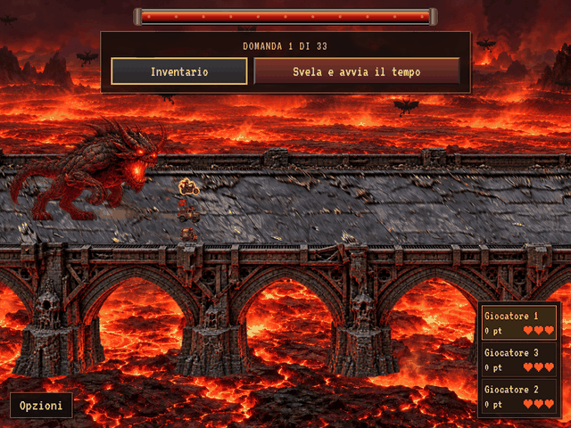

# Nuovo ponte nella schermata di gioco

Acquisizione reale Chromium della revisione `544ba3bb0918e6d3f48de2e1c1040f820e3b13f0`, schermata di gioco con HUD, veicoli e inseguitore. Viewport 1024×768, esportazione 640×480, 6 secondi, 72 fotogrammi a 12 FPS. Nessuna animazione illustrativa sostituisce il renderer.

Ponte di pietra e ferro neri sopra la lava, con facciata e appoggi visibili, aperture trasparenti negli archi, piano carrabile proiettato e bordo anteriore che può occludere i mezzi. Le colonne decorative scartate non sono presenti. Portale, Antisigillo e Sacrificio attendono l’approvazione della strada.

Verifiche: 98 test unitari e dataset, disposizione di 120 terne di veicoli, build normale e offline, caricamento delle texture offline senza richieste esterne, occlusione del bordo, pausa e stato della partita invariato durante la registrazione. Dettagli e checksum in [report.json](report.json).

Riproduzione: `npm run preview:offline && python3 tests/bridge_preview.py` (Playwright, Chromium e Pillow). L’export ridimensiona i fotogrammi del browser senza alterare la scena.
