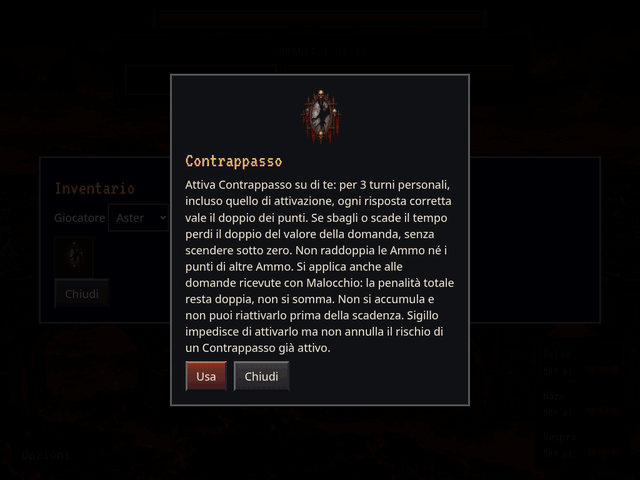

# Contrappasso: attivazione, punti doppi e rischio doppio

GIF reale della schermata di partita in Chromium, dalla revisione
`f7cf667c02e520a4daaa698d80ce59a898e63a88`. Viewport 1024 × 768, esportazione
640 × 480, 13 secondi, 104 fotogrammi a 8 FPS. Nessun mockup: tutti i fotogrammi
provengono dal browser. La fixture controllata usa l’ordine Aster → Moro → Vespro,
500 punti iniziali, domande da 100 punti e due premi Ammo garantiti per rendere
visibile che il loro numero non viene raddoppiato. Le probabilità del prodotto
restano invariate.

1. Aster consulta e attiva Contrappasso: lo specchio sale sul suo veicolo;
   il contatore indica 3 turni personali.
2. Aster risponde correttamente: 500 → 700 punti, due Ammo ottenute.
3. Moro e Vespro svolgono i propri turni. I loro errori ordinari non tolgono
   punti e non modificano il contatore di Aster.
4. Nel secondo turno personale di Aster il contatore indica 2. Un errore
   sottrae 200 punti: 700 → 500, senza perdere vite o le Ammo già possedute.

Contrappasso è ora attivabile su di sé e non trasforma più le Ammo avversarie.
Dura tre turni personali incluso quello di attivazione: 3 → 2 → 1, scadenza
all’inizio del quarto. Non si accumula e una seconda copia non è utilizzabile
finché l’effetto è attivo. Errore e timeout perdono il doppio del valore della
domanda, con minimo zero. Le risposte corrette raddoppiano i punti del solo
rispondente, senza raddoppiare i premi Ammo o i punti di altre Ammo.

Con Malocchio conta il Contrappasso del rispondente: la penalità complessiva
resta ×2, non ×3, e il bonus non passa dall’autore al destinatario. Sigillo
impedisce nuove attivazioni ma non annulla un rischio proprio già attivato;
continua comunque a bloccare i premi Ammo. Flagello non rimuove l’effetto attivo
ai superstiti; eliminazione e Ultimo Miglio lo terminano.

Verifiche completate:

- `npm test`: **145 test passati**, più verifica dei dataset. Coperti attivazione
  manuale, una copia consumata, nessun accumulo o trasformazione passiva,
  punti e frazioni esatti, minimo zero e timeout singolo, probabilità/premi
  invariati, contatore personale e ripristino, Malocchio proprio/ricevuto,
  Sigillo, altre Ammo, eliminazione e Ultimo Miglio.
- Build standard, export offline e demo Ammo completati.
- `node tests/gothic_preview.cjs`: nove animazioni offline in tre viewport.
- `node tests/ammo_animation.cjs --case=karma`: attivazione e cinematica reali
  su desktop e mobile verticale/orizzontale, nessuna mutazione dello stato
  durante il disegno o ripetizione dopo ridisegno.
- `python3 tests/contrappasso_preview.py`: GIF reale, divieto di accumulo,
  penalità propria anche sotto Sigillo, minimo zero e timeout offline,
  tre turni personali completi, salvataggio/ripristino a 3/2/1 e ritorno ai
  punti ordinari e ai premi Ammo al quarto turno. Verificati mobile verticale,
  orizzontale e offline con movimento ridotto: nessun overflow orizzontale,
  richiesta esterna offline o errore JavaScript.

Stati statici integrativi: [seconda copia bloccata](no-stack-390-False.png),
[rischio proprio con Sigillo](own-risk-390-False.png),
[timeout e minimo zero offline](own-risk-390-True.png),
[ritorno ai punti normali](expired-390-False.png),
[orizzontale](expired-844-False.png).

Motore 2.8.0 / regole 25.0.0: il campo persistito `contrappasso` contiene i turni
residui (1–3 oppure null). I salvataggi precedenti conservano copie, punti e
vite senza attivazioni retroattive. Le vecchie Ammo già trasformate mantengono
i loro vincoli storici; gli eventuali Tributi pendenti dividono la base originale
e raddoppiano soltanto la quota del rispondente con Contrappasso attivo.
La migrazione da 2.7.0 conserva esattamente i contatori Sigillo a 2 o 1.
