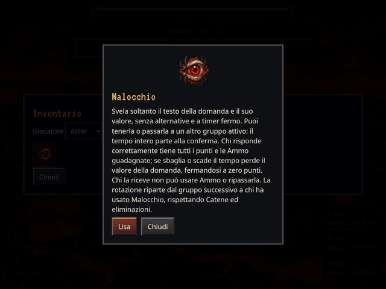

# Malocchio: rischio, destinatario e rotazione

GIF reale della schermata di partita acquisita con Chromium dalla revisione
`44e60317b49c043f4e0c26a82398a6ae26b2680d`. Viewport 1024 × 768, esportazione
640 × 480, 16 secondi, 128 fotogrammi a 8 FPS. Tutti i fotogrammi vengono dal
browser: nessun mockup o animazione illustrativa. La fixture controllata usa
l’ordine Aster → Moro → Vespro, 500 punti e tre vite iniziali per ciascuno,
domande da 100 punti e assegnazione garantita di Sigillo e Antisigillo per
rendere visibili i premi della risposta corretta. Le probabilità del prodotto
restano invariate.

1. Aster consulta e attiva Malocchio: appare solo il testo, senza alternative,
   a timer fermo. Passa la domanda a Vespro, terzo nella rotazione.
2. Vespro risponde erroneamente e perde 100 punti: 500 → 400, senza perdere vite.
3. La prossima domanda va a Moro, successivo all’autore Aster.
4. Moro usa Malocchio, tiene la domanda e risponde correttamente: 500 → 600,
   ricevendo e conservando entrambe le Ammo assegnate.

Il minimo zero è confermato dall’utente. Errore e tempo scaduto sottraggono il
valore della domanda soltanto al rispondente e fino al punteggio disponibile.
La domanda successiva ordinaria non mantiene la penalità. Il destinatario non
può usare Ammo o passare ancora la domanda. Catene ed eliminazioni restano
rispettate; il titolare della rotazione resta l’autore di Malocchio.

Verifiche completate:

- `npm test`: **126 test passati**, più verifica dei dataset. Coperti errore
  proprio o passato a entrambi gli altri gruppi, punti frazionari, minimo zero,
  timeout singolo, nessuna perdita di vite, nove estrazioni indipendenti trattenute
  dal rispondente corretto, nessuna condivisione con vecchi Tributi pendenti,
  rotazione, Catene, eliminazioni, Sigillo, vincoli Contrappasso e Ultimo Miglio.
- Build standard ed export offline completati.
- `node tests/ammo_animation.cjs --case=svela`: cinematica reale su desktop,
  mobile verticale e orizzontale, isolamento dello stato e nessun replay.
- `python3 tests/malocchio_preview.py`: GIF reale, alternative assenti dal DOM
  e dall’accessibilità prima della conferma, tasti risposta inattivi durante
  la scelta, timer fermo/intero, pausa e ripristino attraverso la UI reale,
  minimo zero, premi al destinatario, ordine da autore, nessun overflow
  orizzontale; offline con movimento ridotto e scadenza effettiva del timer,
  senza richieste esterne né errori JavaScript. L’orologio virtuale è installato
  prima del caricamento della UI per includere anche l’intervallo del timer.

Stati statici reali integrativi: [scelta su telefono](peek-390-False.png),
[errore fermato a zero](result-390-False.png),
[premi in orizzontale](result-844-False.png),
[timeout offline con movimento ridotto](result-390-True.png).

Motore 2.6.0, regole 23.0.0: autore e domanda Malocchio persistono nei salvataggi.
Le partite precedenti vengono migrate senza riassegnare punti o riapplicare
esiti storici; una domanda Malocchio ancora aperta acquisisce il rischio e la
rotazione corretta. La coda e le vite dell’Ultimo Miglio restano conservate.
