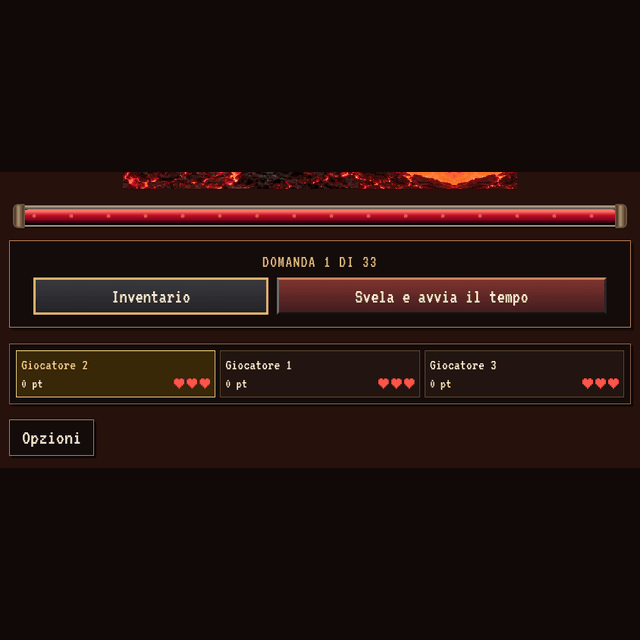

# Gioco solo in orizzontale

Richiesta: eliminare la versione verticale mobile. La regola è registrata anche in [AGENTS.md](../../../AGENTS.md).

GIF acquisita dal browser dalla revisione `34741bcce18df11de27e0f2af67ec0804deee62b`: schermata di gioco, viewport 844×390 → 390×844 → 844×390, **11,5 secondi**, 8 acquisizioni/s. Le schermate sono ridotte uniformemente e centrate su 640×640, con bande; nessuna deformazione. 92 acquisizioni, 54 frame GIF dopo l’accorpamento dei fotogrammi identici. [Metadati e SHA-256](report.json).

## Comportamento

- Il gioco richiede larghezza maggiore dell’altezza, anche in schermo intero e nell’export offline. Le finestre quadrate mostrano lo stesso avviso di rotazione.
- In verticale il palco è nascosto e inerte; il dialogo «Ruota lo schermo» copre anche i menu già aperti. Mouse, tocco e scorciatoie non possono agire sulla partita.
- La rotazione ferma e salva il timer; domanda, punteggi, inventari, pannelli e tempo residuo restano conservati. Il renderer ferma il proprio tempo prima di ridimensionare il canvas, evitando salti nelle animazioni.
- Tornando in orizzontale una domanda fermata dalla rotazione richiede «Riprendi partita». Le animazioni conservano il punto raggiunto; una pausa manuale già attiva resta tale.
- Rimossi gli stili obsoleti della versione verticale e l’impaginazione verticale dello spareggio. I test di gioco usano ora telefoni orizzontali piccoli (667×375), oltre a 844×390 e desktop; le vecchie prove verticali restano documentazione storica.

Stati statici: [avviso verticale](portrait.png), [domanda in pausa dopo la rotazione](landscape-paused.png).

## Verifiche completate

- `npm test`: **145 test**, nessun fallimento; entrambe le banche validate. [Log](logs/unit.txt).
- `npm run test:layout`: **10 combinazioni** tra cinque viewport e DPR 1/2; proporzioni, controlli, scorrimento, rotazione, schermo intero e stato salvato invariato. [Log](logs/layout.txt).
- `python3 tests/orientation.py --capture`: blocco iniziale di home/configurazione/regole, scorciatoie, timer/stato/pixel immobili in verticale, ripresa esplicita, menu conservato, pausa manuale, animazione interrotta dalla rotazione, finestra quadrata, reload del salvataggio, schermo intero con iframe. Ripetuto sul sito e sull’export offline con movimento ridotto; nessun errore JavaScript. [Log](logs/orientation.txt).
- `python3 tests/offline.py`: entrambe le banche su tre viewport orizzontali; flussi domanda, regole, salvataggio/ripresa e nessuna richiesta esterna. Nell’ambiente gestito `file://` è bloccato: testati gli stessi byte dell’export tramite intercettazione locale, con rete disattivata. [Risultati](logs/offline-browser.json).
- Build normale e offline completate. [Log](logs/build.txt).

Le catene generiche `test:browser` e `test:offline` sono state avviate e poi interrotte per concentrare la verifica su questo intervento: **non sono conteggiate come PASS integrali**. Prima dell’interruzione, il test UI generale aveva completato 1440×900 e 667×375, e `tests/offline.py` tutte le sue combinazioni; la successiva suite completa delle animazioni Ammo è stata fermata all’avvio. I messaggi «browser closed» nei [log opzionali](logs/optional-browser-interrupted.txt) corrispondono all’interruzione intenzionale. L’ultima regressione integrale resta documentata nella [consegna precedente](../final-review/README.md).
