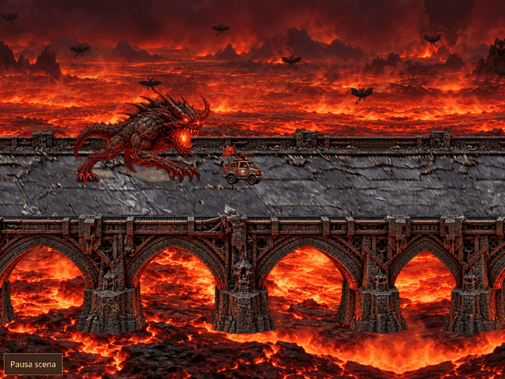

# Portale di salvezza: marmo bianco, azzurro e oro

Acquisizione Chromium della revisione `e67c91ad6414312fe7ce6a8debc8ebf3cafd7a4f`, schermata finale del gioco: 8 secondi, viewport 1024×768, esportazione 640×480, 96 fotogrammi a 12 FPS. Sono fotogrammi del browser, senza sostituzioni illustrative.

Il nuovo asset nativo `portal-azure-v2.png` (948×1659 RGBA) è generato con imagegen e conservato senza modifiche ai pixel. Il renderer proietta la facciata e lo spessore nel mondo, con piedistalli sulla carreggiata, ombre di contatto e luce azzurra nel varco. La facciata posteriore viene disegnata dopo la strada e prima del veicolo; il lato vicino lo occlude durante il passaggio.

La sequenza mostra discesa dall’alto, impatto con solco e detriti, attraversamento del vincitore senza arresto, chiusura e crollo. I frammenti ruotano e cadono, diventando blocchi di marmo con volume, texture e ombre sul piano del ponte. Macerie e solco restano nelle coordinate del mondo. Il ponte approvato, la sincronizzazione della lava e le dimensioni raddoppiate dei veicoli sono preservati. Antisigillo e Sacrificio restano interventi successivi separati.

Verifiche eseguite:

- 103 test unitari e controllo dei dataset; sagome raddoppiate dei sei veicoli, attraversamento completo prima del crollo, appoggi nelle tre corsie, proiezione e spessore, stabilità delle macerie.
- Test browser esistenti del portale con `--quick`: sequenza fino al titolo, pausa/ripresa, orientamento, Game Over e movimento ridotto; 8 campioni offline su desktop e mobile.
- Integrità delle 16 pose del demone e disposizione di 120 combinazioni di veicoli.
- Build normale e offline.
- Registrazione dalla revisione indicata: pausa verificata, stato del motore invariato, un solo evento di completamento, finale e nuovo asset verificati su mobile offline senza richieste esterne.

Misure, fasi e checksum della GIF sono in [report.json](report.json). Riproduzione: `npm run preview:offline && python3 tests/portal_preview.py` con Chromium, Playwright e Pillow. I file HTML di build sono strumenti interni di verifica, non anteprime allegate.
