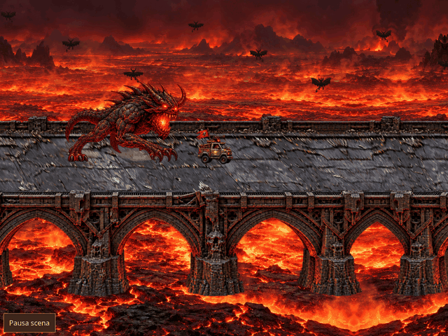

# Portale disegnato nativamente di taglio

Registrazione Chromium della revisione `0903e3d4d3456707757c0bad569c65f22d74fa7c`: 8 secondi, viewport 1024×768, export 640×480, 96 fotogrammi a 12 FPS. È la scena reale del gioco, con lo sprite nuovo e la sequenza approvata.

`portal-side-v3.png` è un nuovo asset RGBA 1024×1536, disegnato di taglio con fiancata, stipiti interni, colonne e tetto volumetrici. Generato con imagegen e copiato senza modifiche ai pixel. L’immagine intera viene posizionata con traslazione e scala uniforme: rimossi la deformazione della facciata frontale e i fianchi ricostruiti da strisce di texture.

La stessa immagine viene ritagliata sul lato vicino per occludere il veicolo durante il passaggio. Luce e ombre usano i riferimenti dello sprite; l’ingombro dei basamenti è verificato nelle tre corsie. I frammenti partono dai ritagli dello sprite nativo con scala uniforme e rotazione rigida. I tempi di discesa, apertura, attraversamento, chiusura, crollo e reazione del demone sono invariati.

Verifiche: 104 test unitari e dataset, incluso un controllo che impedisce trasformazioni affini/scale diverse sui due assi dello sprite integro; appoggi dei basamenti sul ponte in ogni corsia, passaggio dei sei veicoli, macerie permanenti. Build normale/offline riuscite. Nella registrazione: pausa/ripresa, stato del motore invariato, un solo completamento; nuovo asset e finale verificati offline su mobile senza richieste esterne.

Misure, fasi e checksum della GIF: [report.json](report.json). Riproduzione: `npm run preview:offline && python3 tests/portal_preview.py` (Chromium, Playwright e Pillow).
