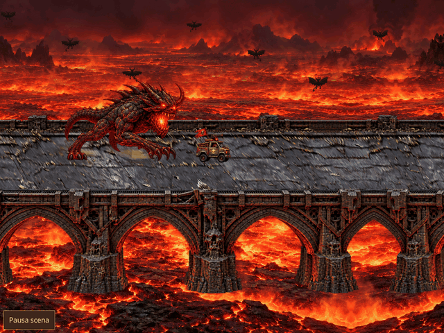

# Oro e crollo in rocce di pietra

Registrazione Chromium della revisione `bb704fca6840b80ab89142795a16571f26d408b7`: 8 secondi, viewport 1024×768, export 640×480, 96 fotogrammi a 12 FPS.

Lo sprite nativo di taglio del portale è preservato, con i suoi dettagli dorati. La vecchia GIF a 128 colori riservava quasi tutta la palette alla lava e perdeva le sfumature dell’oro. L’export ora usa 256 colori: 128 per la scena, 64 per il portale e 64 selezionati dai pixel dorati della registrazione reale. Nessun colore del fotogramma viene ridipinto; cambia la quantizzazione della GIF. Il confronto su 1444 pixel dorati dà un errore medio di tonalità di 1,69°. Il [fotogramma RGB di riferimento](color-reference.png) documenta i colori prima dell’encoding.

Il crollo distacca progressivamente rocce volumetriche di marmo bianco/grigio, con facce di frattura e sei forme native nell’atlante `portal-rocks-v1.png` (1536×1024 RGBA). L’atlante è generato con imagegen e conservato senza modifiche ai pixel. Dopo il distacco si usano le rocce anche in aria: non vengono fatti volare ritagli piatti della facciata. La gravità accelera i pezzi, l’urto produce piccoli rimbalzi e polvere; le rocce si arrestano sulla strada e restano nel mondo con ombre di contatto. I precedenti piccoli frammenti piatti dell’impatto svaniscono prima del crollo.

Preservati vista nativa del portale, durata delle fasi, ponte approvato, lava sincronizzata e veicoli raddoppiati. Antisigillo e Sacrificio restano consegne successive separate.

Verifiche: 106 test unitari e controllo dataset; distacco progressivo, gravità, rimbalzi limitati, appoggi, stato finale stabile a quota zero; verifica che i frammenti rilasciati usino soltanto gli sprite di roccia con scala uniforme. Build normale e offline riuscite. Nella registrazione: controllo del colore, ordine passaggio/crollo, pausa/ripresa, stato del motore invariato e un solo completamento. Portale e atlante delle rocce verificati offline su mobile senza richieste esterne.

Misure, colori, fasi e checksum: [report.json](report.json). Riproduzione: `npm run preview:offline && python3 tests/portal_preview.py` con Chromium, Playwright e Pillow.
