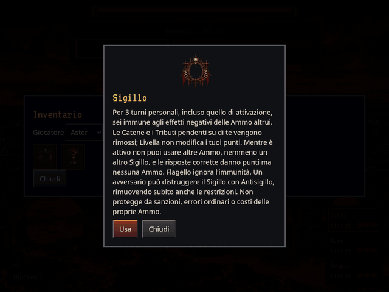

# Sigillo: tre turni e restrizioni Ammo

GIF reale della schermata di partita in Chromium, dal codice
`25a0839c74d5b469c8137d9082513cfc6ea9f237`. Viewport 1024 × 768, esportazione
640 × 480, 17 secondi, 136 fotogrammi a 8 FPS. Tutti i fotogrammi sono acquisiti
dal browser. Fixture controllata: Aster → Moro → Vespro, 1000 punti ciascuno,
domande da 100 punti e due premi garantiti per rendere verificabile il blocco
del guadagno Ammo. Le probabilità reali del prodotto restano invariate.

1. Aster attiva Sigillo; il contatore indica 3 turni personali. Sacrificio è
   presente in inventario ma il pulsante Usa è disabilitato con spiegazione.
2. Aster risponde correttamente: 1000 → 1100 punti, nessuna Ammo ottenuta.
3. Moro usa Tributo su Aster: Sigillo blocca il furto, Aster resta a 1100 punti
   e Moro cede comunque il turno corrente.
4. Vespro usa Antisigillo su Aster: la protezione viene distrutta. Nel turno
   successivo Aster può nuovamente usare Sacrificio.
5. Aster risponde correttamente: 1100 → 1200 punti e riceve le due Ammo previste.

Interpretazione operativa comunicata: **tre turni personali**, incluso quello
di attivazione; 3 → 2 → 1, scadenza all’inizio del quarto. I turni degli altri
non riducono il contatore. **Livella esclude il protetto**, lasciandone invariati
i punti e ripartendo solo quelli dei non protetti. Sigillo elimina Catene e
Tributi pendenti, impedisce nuovi effetti negativi delle Ammo altrui e blocca
ogni altro uso di Ammo, compreso un rinnovo di Sigillo. I punti delle risposte
corrette e le Ammo già possedute restano. **Flagello** passa comunque;
**Antisigillo** elimina subito protezione e restrizioni. Sanzioni e rischi
propri, come un Malocchio autoimposto, non sono neutralizzati.

Verifiche completate:

- `npm test`: **135 test passati**, più verifica dei dataset. Coperti durata
  personale esatta e ripristino a 3/2/1, uso di tutti i tipi rifiutato senza
  consumo, estrazioni soppresse senza consumo RNG, punti corretti mantenuti,
  Catene/Tributo/Malocchio, Livella esatta e bersagli della cinematica,
  Flagello, Antisigillo, rischi propri, migrazione e validazione dei salvataggi.
- Build standard ed export offline completati.
- `python3 tests/sigillo_preview.py`: GIF reale e uso dalla UI; su mobile
  verticale/orizzontale e offline con movimento ridotto, Flagello effettivo
  contro un avversario protetto, blocco uso/guadagno, tre turni personali
  completi con salvataggio/ripristino e ritorno dei premi al quarto turno.
  Nessun overflow orizzontale, richiesta esterna offline o errore JavaScript.
- `node tests/ammo_animation.cjs --case=aura`: animazione reale in tre viewport.
- `python3 tests/antisigillo_preview.py --inspect`: regressione del colpo reale,
  rimozione del solo Sigillo avversario e nessuna variazione di punti/vite.

Stati statici integrativi: [uso bloccato su telefono](locked-390-False.png),
[Flagello supera Sigillo](flagello-390-False.png),
[premi ripristinati alla scadenza](expired-390-False.png),
[orizzontale](expired-844-False.png), [offline](expired-390-True.png).

Motore 2.7.0 / regole 24.0.0: `aura` contiene ora il numero di turni personali
residui (1–3 oppure null), anziché il vecchio turno di attivazione. Le partite
precedenti con Sigillo attivo migrano a tre turni residui, rimuovendo malus
pendenti senza riapplicare punti, danni o esiti storici. Un salvataggio nuovo
con contatore 2 o 1 conserva esattamente quel valore al ripristino.
