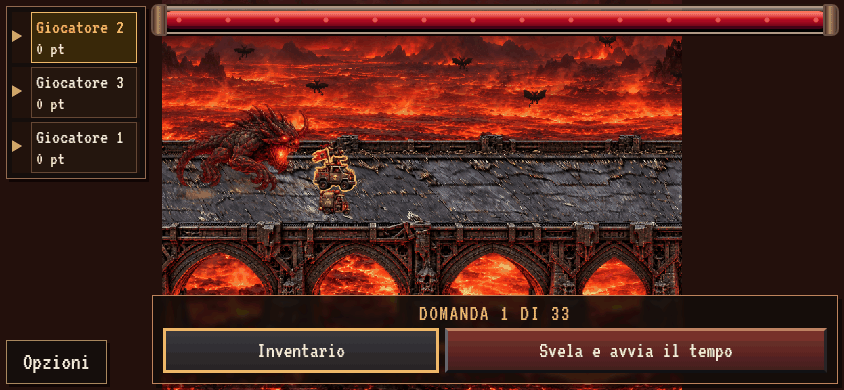

# Evidenze reali — Omen e pannello domande

Tutte le immagini provengono dal browser con il codice proposto. Nessun mockup.
Le impronte dei sorgenti di gioco acquisiti sono in `source-sha256.json`.
Gli sprite definitivi di Arsenico e Cerbero non sono inclusi: «As» è provvisorio.

- `question-open.gif`: viewport 844×390, 2,5 secondi, 20 FPS. Il pannello in basso
  si apre verso l’alto mantenendo fisso il bordo inferiore. `question-capture.json`
  conserva i rettangoli reali prima e dopo l’apertura.
- `arsenico-turns.gif`: viewport 844×390, 10,5 secondi, 5 FPS. Attivazione,
  turno ceduto, primo decremento, rotazione e secondo decremento composto.
  `capture.json` conserva tempi e valori.
- `hud-desktop.png`, `hud-mobile.png`: pannelli superiori e domande in basso.
- `arsenico-active.png`, `arsenico-confirm.png`, `arsenico-second-dose.png`:
  scelta del bersaglio, countdown e decrementi.
- `inventory-omen.png`: nomenclatura Omen e inventario attuale.

Le GIF sono fotogrammi realmente renderizzati; l’orologio virtuale avanza a
intervalli fissi senza cambiare le regole o lo stato applicativo. Riproduzione:
`python3 tests/question_dock_preview.py` e `python3 tests/omen_preview.py`.
I test di overflow provano anche 568×320, DPR 1/2 e il ritorno da portrait.

