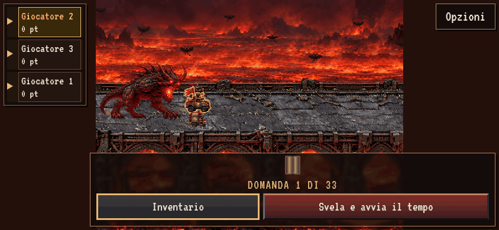
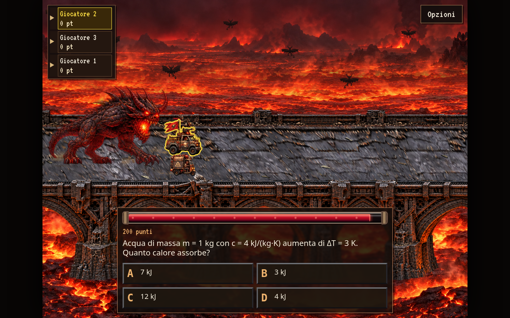
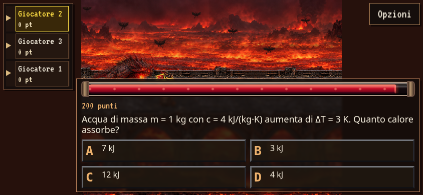

# Timer sopra la domanda e Opzioni in alto a destra

GIF reale del browser: `question-open.gif`, viewport 844×390, durata 2,5 secondi,
20 FPS. La barra del tempo fa parte del pannello che si apre verso l’alto.

Screenshot reali: `question-desktop.png` (1440×900), `question-open.png` (844×390),
`question-mobile-small.png` (667×375) e `question-mobile-min.png` (568×320).
Il controllo Opzioni è visibile nell’angolo superiore destro.

Verifiche: build, `npm run test:omen` (sito/offline, DPR 1/2, orientamento,
ripristino e posizioni), `node tests/hellscape.cjs` (desktop e due landscape
mobile, tutte le domande dei due archivi), audit geometrico senza overflow su
200 quesiti × 3 viewport × 2 stati (domanda/esito).
Le impronte dei sorgenti aggiornati sono in `source-sha256.json`.

Riproduzione:
`HELLSCAPE_PREVIEW_DIR=docs/screenshots/timer-options python3 tests/question_dock_preview.py`

