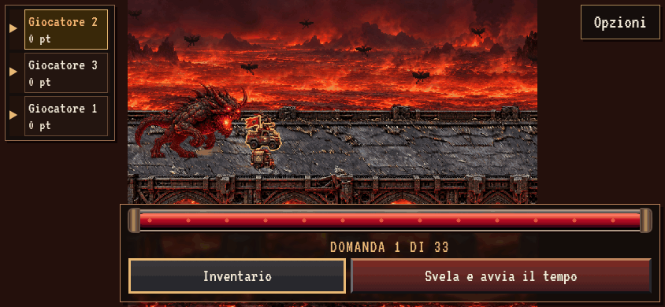

# Barra del tempo a domanda chiusa

Correzione del ridimensionamento intrinseco: la barra conserva tutta la larghezza
anche prima di svelare la domanda. La nuova asserzione di layout controlla che il
timer occupi una parte sostanziale del pannello, oltre alla posizione già verificata.

GIF reale `question-open.gif`: 844×390, 2,5 s, 20 FPS; screenshot desktop 1440×900,
mobile 844×390, 667×375 e 568×320. Superati `npm run test:omen` (sito/offline, DPR,
orientamento e ripristino) e lo script di acquisizione con controlli geometrici.

